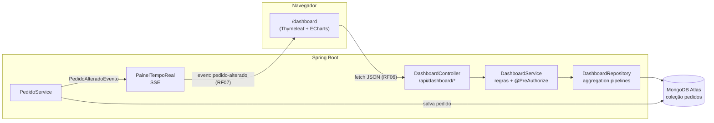

# Dashboard Administrativo — Requisitos e decisões de projeto

Evolução do sistema **PediuPatrão** (pizzaria) com um painel para o responsável pelo
estabelecimento acompanhar vendas, situação dos pedidos e tendências da operação.

- **Atores:** ADMIN e GERENTE (consultam o dashboard). O ATENDENTE gera os dados no dia a dia
  (registra e movimenta pedidos), mas não acessa o painel.
- **Fonte dos dados:** coleção `pedidos` no MongoDB Atlas, preenchida pelas funcionalidades
  da atividade anterior (itens, valores calculados no servidor, status, entrada e saída).

## 1. Requisitos funcionais

### RF01 — Indicadores gerais de vendas
O dashboard mostra, para o período filtrado:

- faturamento;
- quantidade de pedidos;
- ticket médio;
- itens vendidos;
- clientes atendidos;
- total de descontos;
- cancelamentos (quantidade, taxa e valor perdido);
- tempo médio entre a entrada e a saída do pedido.

**Regras:**
- Pedidos **cancelados** contam no total de pedidos e na taxa de cancelamento, mas **não** entram no faturamento, no ticket médio nem nos itens vendidos.
- Ticket médio = faturamento ÷ pedidos não cancelados.
- Faturamento e pedidos são comparados com o **período anterior de mesmo tamanho** (ex.: 01–10/11 contra 22–31/10). Quando o período anterior não teve vendas, a variação fica vazia, porque não existe crescimento a partir de zero.

**Implementação:** `GET /api/dashboard/resumo` (`DashboardService.resumo`).

### RF02 — Análise de vendas (gráficos)
O dashboard tem três gráficos de vendas:

- faturamento e pedidos ao longo do tempo, agrupados **por dia, mês, hora do dia ou dia da semana**, com indicação do melhor período;
- distribuição de pedidos por hora (horário de pico);
- divisão entre entrega e retirada.

**Regras:**
- Períodos sem venda aparecem com zero, para o gráfico não "pular" dias.
- Os agrupamentos usam o fuso de Brasília. Um pedido das 22h não aparece no dia seguinte por causa do UTC.

**Implementação:** `GET /api/dashboard/vendas` e `GET /api/dashboard/canais`.

### RF03 — Situação dos pedidos
Quantidade e percentual de pedidos em cada status no período (Recebido, Em preparação,
Pronto, Saiu/Retirado, Finalizado, Cancelado). Também mostra a **fila de pedidos abertos agora**,
do mais antigo para o mais novo, com o tempo em aberto.

**Regras:**
- A fila ignora o filtro de período: é uma visão operacional do momento.
- Pedido aberto há mais de **40 minutos** é destacado como atrasado.

**Implementação:** `GET /api/dashboard/pedidos/situacao`.

### RF04 — Produtos mais vendidos
Ranking dos produtos ordenado por **unidades** ou por **valor**, com posição, quantidade,
faturamento, número de pedidos e participação (%) no total.

**Regras:**
- Pedidos cancelados ficam fora do ranking.
- O valor por produto é o dos itens **antes** do desconto do pedido, porque o desconto é dado no pedido inteiro e não em um item.
- O limite do ranking vai de 1 a 20 (padrão 5).

**Implementação:** `GET /api/dashboard/produtos/ranking`.

### RF05 — Filtros de consulta
Filtros disponíveis, que valem para **todos** os indicadores e gráficos ao mesmo tempo:

- período (data inicial e final);
- status (um ou vários);
- forma de saída (entrega ou retirada);
- produto.

A tela também tem atalhos (Hoje, 7 dias, 30 dias, Este mês). O filtro fica salvo na URL, então recarregar a página não perde a consulta.

**Regras:**
- Sem datas, o período é dos **últimos 30 dias**.
- A data inicial não pode ser posterior à final.
- O período tem no máximo **366 dias**.
- Valores inválidos retornam **400** com uma mensagem explicativa.

**Implementação:** `FiltroDashboard` e `FiltroDashboardParams`; a tela busca os valores aceitos em `GET /api/dashboard/opcoes`.

### RF06 — Integração com a API
A página `/dashboard` não recebe números do servidor ao ser renderizada: o JavaScript
(`static/js/dashboard.js`) consome os endpoints REST de `/api/dashboard` e monta os gráficos com
Apache ECharts. A mesma API pode ser usada por outro sistema (aplicativo, BI) com HTTP Basic.

### RF07 — Atualização e tratamento de dados
**Atualização:**
- Quando um pedido é criado, muda de status, recebe desconto ou é cancelado, o servidor avisa os dashboards abertos por **Server-Sent Events** (`GET /api/dashboard/eventos`), e a tela recarrega os dados sozinha.
- Se a conexão cair, o navegador tenta reconectar e, enquanto isso, a tela atualiza a cada 60 s.
- Também há um botão **Atualizar** e a hora da última atualização.

**Tratamento de dados:**
- **No banco:** os valores em dinheiro são convertidos com `$toDecimal` antes de somar, sem perder centavos. Pedidos do modelo antigo (sem itens) ficam fora das contas.
- **No servidor:** arredondamento HALF_EVEN para dinheiro, preenchimento de períodos vazios e proteção contra divisão por zero.
- **Na tela:** formatação em R$ e pt-BR; mensagens para períodos sem dados; cada bloco carrega independente, então se um falhar os outros continuam; nomes vindos do banco nunca são interpretados como HTML.

## 2. Requisitos não funcionais

| Código | Categoria | Requisito |
|---|---|---|
| RNF01 | Segurança | Dashboard e API acessíveis só a ADMIN e GERENTE, garantido no backend em duas camadas (regra de rota no `SecurityConfig` e `@PreAuthorize` no `DashboardService`). Sem login: 401; perfil sem permissão: 403, registrado na auditoria. |
| RNF02 | Segurança | A API do dashboard é somente leitura (apenas `GET`) e não expõe dados pessoais além do nome do cliente na fila de pedidos. |
| RNF03 | Desempenho | Os cálculos são feitos no MongoDB (aggregation pipeline), sem trazer todos os pedidos para a aplicação. Cada bloco do dashboard faz uma única consulta ao banco. |
| RNF04 | Desempenho | O período consultado é limitado a 366 dias e o ranking a 20 itens, para manter o tempo de resposta previsível. |
| RNF05 | Usabilidade | Mesma identidade visual do sistema (Bootstrap e barra lateral), layout responsivo, valores em formato brasileiro e gráficos com tooltip. |
| RNF06 | Confiabilidade | O tempo real tem plano B: se o SSE cair, a tela atualiza periodicamente. Uma falha em um bloco não derruba o painel inteiro. |
| RNF07 | Interoperabilidade | Respostas em JSON e erros no padrão *Problem Details* (RFC 7807), iguais aos do restante da API. |
| RNF08 | Manutenibilidade | Mantém a arquitetura em camadas (controller → service → repository). Regras de negócio ficam no service e são cobertas por testes automatizados. |
| RNF09 | Exatidão | Datas agrupadas no fuso America/Sao_Paulo e valores em `BigDecimal`/`Decimal128`, sem `double` para dinheiro. |

## 3. Decisões de análise e projeto

| Decisão | Alternativas consideradas | Por que foi escolhida |
|---|---|---|
| **Aggregation pipeline no MongoDB** (`$match`, `$group`, `$unwind`, `$facet`) | Buscar os pedidos e somar em Java | O banco devolve só o resultado. Com milhares de pedidos, trafega muito menos dado. O pipeline é o mesmo que se testaria no Atlas, o que facilita validar. |
| **Server-Sent Events** para tempo real | Polling a cada X segundos; WebSocket | O dashboard só precisa *receber* avisos. O SSE é HTTP comum, passa pela mesma autenticação e reconecta sozinho. O WebSocket seria mais complexo sem ganho; o polling geraria consultas desnecessárias. |
| **Evento interno** (`PedidoAlteradoEvento`) publicado pelo `PedidoService` | Chamar o painel direto do service | Desacopla: o `PedidoService` não conhece o dashboard. Dá para adicionar outros ouvintes no futuro (e-mail, impressora da cozinha) sem mexer nele. |
| **Apache ECharts** | Chart.js, ApexCharts | Tem gráfico de eixo duplo (barras + linha), rosca e barras horizontais com boa interatividade, em uma única biblioteca. |
| **Endpoints por assunto** (`/resumo`, `/vendas`, `/pedidos/situacao`, `/produtos/ranking`, `/canais`) | Um endpoint único com tudo | Cada bloco da tela carrega e falha de forma independente, e cada endpoint pode ser reutilizado e testado separadamente. |
| **Faturamento sem cancelados**; valor cancelado à parte | Somar tudo | Reflete o que de fato entrou no caixa e ainda mostra quanto se perdeu com cancelamentos. |
| **Comparativo com período anterior** | Mostrar só o valor atual | "Faturou R$ 12 mil" sozinho não diz se é bom; a variação mostra a tendência. |
| **Carga de demonstração opcional** | Inserir dados à mão | Permite demonstrar tendências (picos, dias da semana) com volume realista, sem misturar com o uso normal (desligada por padrão e marcada como "Pedido de demonstração"). |

## 4. Arquitetura

### Campos do pedido usados pelo dashboard

| Campo | Uso |
|---|---|
| `entradaEm` | Filtro de período e agrupamento por dia, mês, hora e dia da semana |
| `status` | Situação dos pedidos, filtro de status, separar cancelados |
| `valorTotal`, `valorDescontos` | Faturamento, ticket médio, descontos, valor cancelado |
| `itens[]` (`produtoId`, `nomeProduto`, `quantidade`, `subtotal`) | Ranking de produtos, itens vendidos, filtro por produto |
| `clienteId`, `clienteNome` | Clientes atendidos, fila de pedidos |
| `saidaEm`, `modalidadeSaida` | Tempo até a saída, entrega x retirada |

## 5. Fluxo de trabalho (Gitflow)

| Branch | Conteúdo |
|---|---|
| `main` | Versões entregues (tag `v2.0.0` para esta atividade) |
| `develop` | Integração das features |
| `feature/dashboard-api` | Filtros, aggregation, service, endpoints e SSE |
| `feature/dashboard-front` | Tela, gráficos e consumo da API |
| `feature/dados-demonstracao` | Carga opcional de pedidos de exemplo |
| `feature/documentacao-dashboard` | Esta documentação, a da API e as evidências de teste |
| `release/2.0.0` | Preparação da versão (número da versão no `pom.xml`) antes de ir para a `main` |
